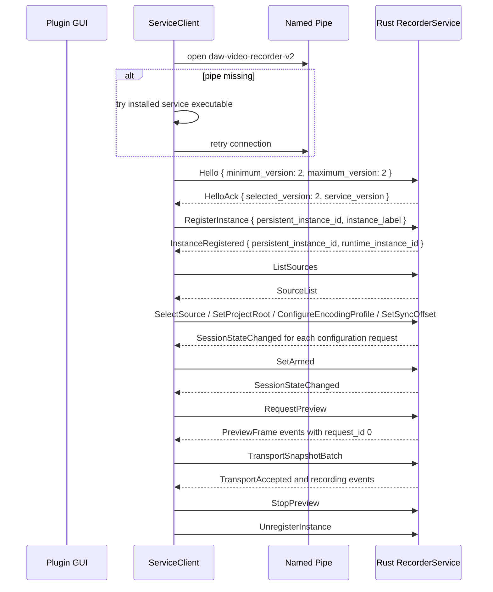

# Core-to-GUI IPC and API handoff

This document is the shared integration reference for Codex-owned recording/core work and Antigravity-owned VST presentation work. It describes the implementation in this repository, not a future design.

## 1. Authority and ownership

Use these sources in this order:

1. `protocol/daw_video_recorder.proto` is the canonical wire schema.
2. `recorder/src/protocol.rs` is the Rust schema mirror used by `prost`.
3. `plugin/src/ProtocolCodec.*` is the C++ schema mirror and hand-written compatible codec.
4. This document explains behavior, threading, defaults, and ownership that are not fully expressed by the schema.

If these sources disagree, do not silently choose one. Reconcile the `.proto`, both mirrors, this document, and tests in one Codex-owned change.

Codex owns the Rust service, camera/OS integration, recording, DAW transport capture, wire protocol, C++ service client, and `PluginProcessor` facade. Antigravity owns JUCE presentation code. Presentation code consumes `PluginProcessor`; it does not call the pipe, codec, camera APIs, or Rust service directly.

## 2. Process and thread topology

```text
DAW process
  Audio callback
    PluginProcessor::processBlock
      -> SpscQueue<TransportSnapshot, 2048>

  ServiceClient worker thread
    -> drains transport snapshots in batches of at most 64
    -> synchronizes source, project root, encoding, offset, arm, and preview state
    -> writes framed requests to the Named Pipe

  ServiceClient receiver thread
    <- reads every framed response/event from the Named Pipe
    -> correlates request responses by request_id
    -> stores preview/finalized-take snapshots under short locks

  JUCE message thread
    PluginEditor timer -> PluginProcessor snapshots -> VideoPreviewComponent

Rust service process
  Tokio connection task per Named Pipe client
    -> handles control requests
    <- receives preview frames from a bounded Tokio channel
    -> serializes all responses/events onto that connection

  Preview bridge thread per successful RequestPreview path
    <- bounded std::sync channel from capture thread
    -> bounded Tokio preview channel

  Media Foundation capture thread per physical source_id
    -> camera sample conversion/downsampling
    -> shared encoders and independent recording writers
    -> non-blocking preview dispatch to each runtime subscriber
```

The audio callback only writes fixed-size transport snapshots to the SPSC queue. Named Pipe access, camera operations, encoding, file I/O, blocking waits, and GUI work stay off the audio thread.

## 3. Transport and framing

| Property | Current value |
|---|---|
| Supported service platform | Windows only |
| Windows pipe | `\\.\pipe\daw-video-recorder-v2` |
| JUCE pipe identifier | `daw-video-recorder-v2` |
| Protocol version | `2` |
| Payload encoding | Protocol Buffers-compatible `Envelope` |
| Frame prefix | 4-byte unsigned little-endian payload length |
| Maximum encoded envelope | 4 MiB on both Rust and C++ sides |
| C++ I/O timeout | 3 seconds for normal request/response I/O |

A packet is exactly:

```text
[payload_length: u32 little endian][serialized Envelope bytes]
```

`Envelope.protocol_version` is set to `2`. `Envelope.request_id` identifies a request and its direct response. The client uses monotonically increasing request IDs per `ServiceClient` connection.

The service sends preview frames as unsolicited events with `request_id = 0`. They can be interleaved with ordinary responses. The receiver thread must therefore continuously dispatch by payload kind before request correlation.

The C++ source contains a non-Windows socket path constant, but the Rust service explicitly rejects non-Windows startup. Treat Windows as the only implemented platform.

## 4. Connection and session lifecycle



`persistent_instance_id` is saved with the plug-in state. Registration always creates a connection-scoped `runtime_instance_id`; duplicated plug-in state can therefore create independent runtime sessions without ID collision. All session-specific requests after registration use the runtime ID.

When a connection ends, the Rust connection task unregisters every runtime instance created through that connection. Unregistering also removes preview subscriptions and releases prepared capture state when no remaining session needs it.

## 5. Message contract

### 5.1 Client requests

| Envelope field | Message | Purpose | Success behavior |
|---:|---|---|---|
| 10 | `Hello` | Negotiate an overlapping protocol version. | `HelloAck` |
| 11 | `RegisterInstance` | Create a runtime session from a persistent plug-in identity. | `InstanceRegistered` |
| 12 | `UnregisterInstance` | Remove a runtime session. | No success response |
| 13 | `ListSources` | Re-enumerate local video capture devices. | `SourceList` |
| 14 | `SelectSource` | Bind a runtime session to a stable camera source ID. | `SessionStateChanged` |
| 15 | `SetProjectRoot` | Set the directory under which recordings are created. | `SessionStateChanged` |
| 16 | `SetArmed` | Prepare/release capture and allow DAW record edges to control takes. | `SessionStateChanged` |
| 17 | `TransportSnapshotBatch` | Deliver ordered DAW callback snapshots. | `TransportAccepted`, plus state/finalization events when applicable |
| 18 | `Heartbeat` | Check liveness and sequence echo. | `HeartbeatAck` |
| 19 | `ConfigureEncodingProfile` | Set bitrate, GOP duration, and hardware preference. | `SessionStateChanged` |
| 20 | `SetSyncOffset` | Apply a configured signed nanosecond offset. | `SessionStateChanged` |
| 21 | `RequestPreview` | Subscribe this runtime instance to preview frames. | No success response; frames arrive asynchronously |
| 22 | `StopPreview` | Remove this runtime instance's preview subscription. | No success response |

`SelectSource`, `SetProjectRoot`, `SetArmed`, and encoding changes may transition the session into preparation when enough configuration is present. The service response reports the resulting state rather than acknowledging only field storage.

### 5.2 Service responses and events

| Envelope field | Message | Notes |
|---:|---|---|
| 30 | `HelloAck` | Selected protocol and service package version. |
| 31 | `InstanceRegistered` | Returns the new runtime ID. |
| 32 | `SourceList` | Snapshot of currently enumerated cameras. |
| 33 | `SessionStateChanged` | Runtime ID, state enum, and optional detail. |
| 34 | `RecordingFinalized` | Take ID and final video/metadata paths. |
| 35 | `Error` | Stable error code, detail, related IDs, and recoverability flag. |
| 36 | `HeartbeatAck` | Echoes the heartbeat sequence. |
| 37 | `TransportAccepted` | Last runtime ID and sequence accepted from a batch. |
| 38 | `PreviewFrame` | Unsolicited preview pixels; normally `request_id = 0`. |

The current service error codes are:

- `empty_payload`
- `protocol_version_mismatch`
- `unexpected_response`
- `unknown_instance`
- `invalid_session_operation`
- `source_enumeration_failed`
- `source_unavailable`
- `recording_failed`

The service currently marks generated errors as recoverable. The GUI should still present the detail and connection/session context; it must not infer that retrying every error indefinitely is safe.

## 6. Camera source enumeration

`ListSources` calls Windows Media Foundation device enumeration using the video-capture source type and full Media Foundation startup. Each returned source contains:

| Field | Current meaning |
|---|---|
| `source_id` | Media Foundation capture symbolic link. This is the stable value persisted and sent back in `SelectSource`. |
| `display_name` | Media Foundation friendly name for display. It is not an identity key. |
| `formats` | Present in the schema but currently empty. |
| `available` | `true` for each device returned by the current enumeration. |

The Rust service sorts sources by `display_name`. The C++ codec currently retains `source_id`, `display_name`, and `available`, and skips `formats`. Resolution and frame-rate selection are therefore not part of the current GUI-facing source model.

`ServiceClient` refreshes the source list on connection, when requested by the GUI, and on its refresh schedule. It replaces its source snapshot under `sourceLock` and increments `sourceListRevision`. The GUI copies the source vector through `PluginProcessor::availableSources()` and uses the revision to avoid rebuilding unchanged controls.

## 7. Preview request semantics

`RequestPreview` carries:

| Field | Service behavior |
|---|---|
| `runtime_instance_id` | Must identify a registered session with a selected source. |
| `width` | `0` defaults to 480; otherwise used as the requested output width. |
| `height` | `0` defaults to 270; otherwise used as the requested output height. |
| `max_fps` | `0` defaults to 30; nonzero values are clamped to 1 through 60. |

The current C++ client always requests 480x270 at 30 fps. A successful request has no direct acknowledgement. An invalid runtime or a session without a selected/prepared source returns `Error` with the original request ID.

Calling `RequestPreview` again for the same runtime instance replaces its capture subscription. Changing the selected source also causes the client to request a fresh preview when preview is enabled.

`StopPreview` is fire-and-forget on success. It removes the runtime subscriber. If a capture has no recording-profile users and no preview users, the shared physical-camera capture is released.

## 8. Preview pixel data flow


The capture thread receives a Media Foundation sample in the selected native uncompressed format. `generate_preview_frame` converts and downsamples it to row-major RGB24:

```text
frame_data length = width * height * 3
pixel byte order   = R, G, B, R, G, B, ...
row layout         = contiguous rows produced by the format-specific helper
format string      = "rgb24"
timestamp_ns       = service monotonic arrival time in nanoseconds
```

The timestamp is taken from the Windows performance-counter-backed monotonic clock when the sample arrives in the capture loop. It is not the Media Foundation stream timestamp and is not a wall-clock time.

Rust currently emits only `rgb24`. `VideoPreviewComponent` can also decode a `jpeg` format value, but no current Rust path produces JPEG preview data. New format strings require a coordinated core/API change and a GUI fallback for unsupported formats.

### Backpressure

Preview delivery is deliberately lossy:

1. The capture thread uses `try_send` into a capacity-2 synchronous channel per IPC request.
2. A full channel causes the current preview frame to be dropped; capture and recording continue.
3. A disconnected channel removes that subscriber from the capture thread.
4. The bridge thread forwards into a capacity-4 Tokio channel with `blocking_send`.
5. The Tokio connection task serializes preview frames and control responses onto the same pipe writer.

There is no preview-drop counter in the current GUI contract. Do not add blocking waits to preserve every preview frame: recording correctness has priority over preview continuity.

At 480x270 RGB24, pixel data is 388,800 bytes before Protocol Buffers overhead, safely below the 4 MiB envelope limit. Larger requested dimensions must still fit the encoded-envelope limit.

## 9. C++ receive and GUI-facing facade

`ServiceClient::ReceiverThread` is the only continuous reader for the pipe:

- `PreviewFrame` bypasses request correlation and updates `currentPreviewFrame`.
- `RecordingFinalized` updates the finalized-take snapshot and can also satisfy a correlated request when it has a nonzero request ID.
- A request is completed only by its expected response kind or by `Error`. Other responses with the same nonzero request ID are dispatched as events without overwriting the pending result. This is required because a transport batch can emit `SessionStateChanged`, `RecordingFinalized`, and `TransportAccepted` with the same request ID.

`ServiceClient::PreviewFrameData` contains:

```cpp
std::uint32_t width;
std::uint32_t height;
juce::String format;
std::vector<std::uint8_t> frameData;
std::int64_t timestampNs;
std::uint64_t revision;
```

The receiver copies a complete decoded frame under `previewLock` and increments `revision`. `latestPreviewFrame()` returns a copy, so presentation code does not retain service-owned memory. The GUI skips an unchanged revision, converts supported data into a `juce::Image`, and paints from its own image snapshot.

Antigravity may use these `PluginProcessor` capabilities:

| GUI need | Facade |
|---|---|
| Service status | `serviceConnectionState()`, `serviceStatusText()` |
| Camera list | `availableSources()`, `sourceListRevision()`, `requestSourceRefresh()` |
| Camera selection | `selectedSourceId()`, `setSelectedSourceId()` |
| Project directory | `projectRoot()`, `setProjectRoot()` |
| Encoding controls | `encodingPreset()`, `setEncodingPreset()`, hardware preference accessors |
| Sync correction | sync-offset accessors |
| Preview lifecycle | `isPreviewEnabled()`, `setPreviewEnabled()` |
| Preview pixels | `latestPreviewFrame()` |
| Record state | `isArmed()`, DAW playing/recording accessors |
| Latest output | `latestFinalizedTake()` |
| Diagnostics | sent/dropped snapshot counters and worker state |

If presentation work needs a new method or snapshot field, Antigravity creates a handoff. Codex adds the core/facade behavior and documents lifetime and compatibility before the GUI consumes it.

## 10. Recording and DAW transport boundary

`PluginProcessor::processBlock` captures a `TransportSnapshot` for each DAW callback and pushes it into a capacity-2048 SPSC queue without waiting. The background client drains up to 64 snapshots per request. `TransportSnapshotBatch` preserves callback sequence numbers and carries sample position, rate, playing/recording/loop/offline flags, and optional musical context.

The Rust session state machine uses the callback monotonic timestamp for recording edges. IPC delivery time is not the recording start time. Prepared capture, encoded GOP buffering, tail holdback, and metadata generation are core behavior and must not be reimplemented or inferred in the GUI.

Successful takes are atomically promoted from `<stem>.mp4.part` to `<stem>.mp4`, then receive `<stem>.sync.json` metadata. The GUI take browser accepts both this current metadata name and the legacy `<stem>.mp4.json` form. A `.part` file is never presented as a finalized take.

`sync_offset_ns` is `first_frame_monotonic_time_ns - corrected_start_monotonic_time_ns`.
Recorded playback maps a DAW position to time since the first MP4 frame as
`(current_project_sample - start_project_sample) / sample_rate - sync_offset_ns / 1e9`.
A negative offset means the MP4 begins before the DAW take start. Auto view selects recorded
playback while the DAW is playing and a take is selected, even if Record Arm remains enabled;
active DAW recording still selects live preview. This is a GUI-internal policy and does not
change the wire protocol or `PluginProcessor` facade.

Finalized paths may use the Windows extended-path `\\?\` prefix. GUI code must not rewrite the
stored metadata path, but `MFVideoDecoder` removes that prefix from the path passed to
`MFCreateSourceReaderFromURL` because the source reader rejects otherwise valid local MP4 files
in that form. UNC extended paths are converted from `\\?\UNC\server\share` to
`\\server\share` for the same call.

The GUI may display state and finalized paths. It does not decide when a take begins or ends.

## 11. Current limitations and planned extensions

The following are not part of the implemented contract:

- Shared-memory preview transport. Preview bytes currently travel inline in `PreviewFrame` on the control pipe.
- GUI format/resolution/frame-rate enumeration. `VideoSource.formats` is empty and skipped by C++.
- Rust JPEG preview emission.
- A preview-start or preview-stop success acknowledgement.
- Preview drop/latency metrics exposed to the GUI.
- Automatic preview shutdown tied to closing or hiding the plug-in editor. The processor currently enables preview by default, and preview changes follow `setPreviewEnabled`; editor visibility does not yet guarantee `StopPreview`.
- Non-Windows service operation.

Windows named shared memory remains a possible future optimization for larger or higher-rate previews. It must be introduced as an explicit versioned/negotiated contract with ownership, lifetime, synchronization, cleanup, and fallback rules. Do not describe it as the current data path.

## 12. Change checklist

For a wire or GUI-facing facade change:

1. Create or update a record in `.agents/handoffs/`.
2. Update `protocol/daw_video_recorder.proto` when the wire changes; never reuse field numbers.
3. Update `recorder/src/protocol.rs`, Rust handlers, and Rust tests.
4. Update `plugin/src/ProtocolCodec.*`, `ServiceClient.*`, and `PluginProcessor.*` as needed.
5. Update this document, `protocol/README.md`, and implementation status.
6. Test framing, encode/decode behavior, error handling, reconnect, and interleaved preview/control traffic.
7. Run Rust checks and the VST3/IPC smoke builds appropriate to the change.
8. Mark the handoff `ready-for-gui`; Antigravity then integrates only through the documented facade.
