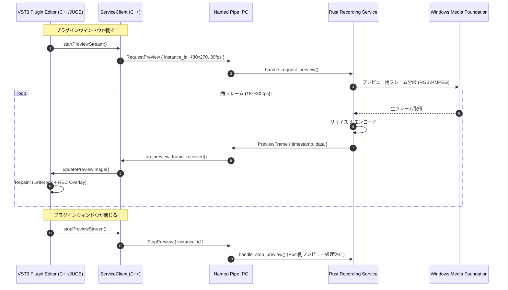

# GUI & Video Preview アーキテクチャ設計書

本ドキュメントは、DAW Video Recorder におけるカメラ映像プレビュー表示およびVST3プラグインGUI刷新の基本設計と実装方針をまとめたものです。

---

## 1. 全体アーキテクチャ概要

DAW Video Recorder のプロセス間映像プレビューおよびGUI描画は以下のフローで動作します。



---

## 2. 技術スタック選定

| コンポーネント | 採用技術 | 選定理由・ライセンス適合性 |
|---|---|---|
| **プラグインGUI** | **C++20 / JUCE 7/8 (`juce_gui_basics`, `juce_gui_extra`)** | DAW環境での標準的フレームワーク。AGPLv3適合。スレッド安全なタイマー・アトミック更新機構。 |
| **映像描画エンジン** | **JUCE 2D Graphics Engine (`juce::Graphics`, `juce::Image`)** | GPUコンテキスト（OpenGL/DirectX）の共有競合やホストDAWとの衝突を回避し、CPU負荷を最小化。 |
| **プレビューIPC伝送** | **Named Pipe Protocol拡張 (`daw_video_recorder.proto`)** | 第1段階としてProtocol Buffers形式で低解像度プレビューフレーム（RGB24 / JPEG）を伝送。プロトコルの統一性・ポータビリティが高い。 |
| **高効率拡張 (Phase 5.5+)** | **Windows Named Shared Memory (`CreateFileMappingW`)** | 大画面・高fpsでのゼロコピー伝送オプショナル対応。 |
| **サービス側画像処理** | **Rust (`image` または Media Foundation RGB/NV12 変換)** | MIT/Apache-2.0ライセンス互換。安全かつ高速なメモリ操作。 |

---

## 3. UIコンポーネント構成と画面レイアウト

```text
+-----------------------------------------------------------------------------------------------+
|  DAW Video Recorder - [Instance: Camera-1]                [Service: Connected / Ready]        |
+-------------------------------------------------------------+---------------------------------+
|                                                             |  [  RECORD ARM  ] (Large Button)|
|                                                             |                                 |
|                     VIDEO PREVIEW                           |  Camera Source:                 |
|                                                             |  [ Logitech Brio 4K          v] |
|              +---------------------------+                  |                                 |
|              |                           |                  |  Encoding Profile:              |
|              |   [● REC 00:01:23]        |                  |  [ Balanced H.264 / 8 Mbps   v] |
|              |                           |                  |  [x] Prefer Hardware Encoder    |
|              |                           |                  |                                 |
|              |                           |                  |  Project Root:                  |
|              |              30.0 fps     |                  |  [ C:/Projects/MySong   ] [...] |
|              +---------------------------+                  |                                 |
|                                                             |  Sync Offset:                   |
|                                                             |  [-------|-------]  +0.0 ms     |
+-------------------------------------------------------------+---------------------------------+
|  Metrics: Transmitted: 1,420 pkts | Drop: 0 | Buffer: 0.2s                                    |
|  Last Take: face-camera_take-001.mp4                         [ Open Folder ] [ Reveal File ]  |
+-----------------------------------------------------------------------------------------------+
```

### 主要UIモジュール
1. **`VideoPreviewComponent`**:
   - レターボックス/ピラーボックスアスペクト比維持描画
   - 状態バナー（Disconnected, Idle, Preparing, Armed, Recording, Finalizing, Error）
   - 録画中点滅RECマーク ＆ タイムコードオーバーレイ（`00:00:00.000`）
   - 非表示時自動ストリーム停止（`visibilityChanged` による省電力化）
2. **`ControlSidebarComponent`**:
   - 大きく押しやすいRecord Armトグルボタン（状態に応じたカラーチェンジ）
   - カメラ選択（共有状態バッジ付き）
   - エンコーディングプロファイル・ハードウェアエンコーダー優先設定
   - Project Rootセレクタ
   - 同期オフセットスライダー
3. **`FooterBarComponent`**:
   - リアルタイムパフォーマンス・ドロップフレーム情報
   - 最新テイク情報表示 ＆ ワンクリックフォルダオープンボタン（`juce::File::revealToUser()`）

---

## 4. 実装ステップ計画

1. **Step 1: プロトコル拡張**:
   - [daw_video_recorder.proto](file:///C:/Users/hiro2/Documents/repo/daw-video-recorder/protocol/daw_video_recorder.proto) に `RequestPreview`, `StopPreview`, `PreviewFrame` を追加。
   - C++側の [ProtocolCodec.h](file:///C:/Users/hiro2/Documents/repo/daw-video-recorder/plugin/src/ProtocolCodec.h) と Rust側の [protocol.rs](file:///C:/Users/hiro2/Documents/repo/daw-video-recorder/recorder/src/protocol.rs) を更新。
2. **Step 2: Rust録画サービスにおけるプレビュー生成と配信**:
   - キャプチャパイプラインからプレビュー用のダウンサンプリングフレームを取得し、IPCクライアントへ非同期配信。
3. **Step 3: VST3プラグイン `VideoPreviewComponent` の実装**:
   - 受信したプレビューフレームを `juce::Image` へデコードし、ダブルバッファで描画。
4. **Step 4: PluginEditor のレイアウト刷新**:
   - 2ペインUIレイアウトの構築、コントロールの再配置、フォルダオープン機能の実装。
5. **Step 5: 動作検証と負荷測定**:
   - DAW録音中のプレビュー描画がオーディオ処理に影響を与えないことの確認。
