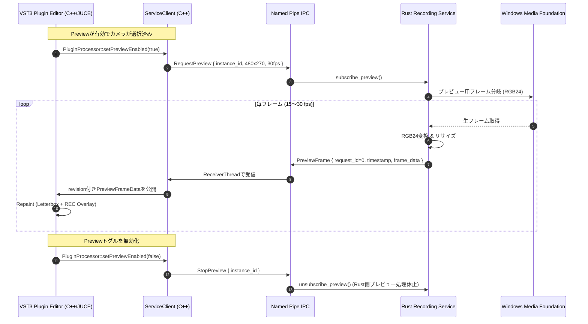

# GUI & Video Preview アーキテクチャ

本ドキュメントは、DAW Video Recorder における実装済みのカメラ映像プレビュー表示とVST3 GUI構成、および未実装の拡張をまとめたものです。IPCの正確なフィールド、スレッド、キュー、バックプレッシャーは [Core-to-GUI IPC and API handoff](IPC_API_HANDOFF.md) を正本とします。

---

## 1. 全体アーキテクチャ概要

DAW Video Recorder のプロセス間映像プレビューおよびGUI描画は以下のフローで動作します。



`RequestPreview`と`StopPreview`は成功時に直接の応答を返しません。`PreviewFrame`は制御メッセージと同じNamed Pipe上へ非同期に送られます。プラグインウィンドウの非表示・破棄と自動連動する停止処理は、現時点では未実装です。

### 表示ソース選択と録画テイク同期

GUIは`VideoPlaybackPolicy`でライブ映像と録画済み映像の選択を一度だけ決定し、その結果をMP4デコーダー、プレビュー購読、描画へ共通で渡します。Autoモードでは、DAW録音中はライブ、DAW再生中で選択テイクがある場合はArm状態にかかわらず録画済み映像を表示します。停止中はArm有効ならライブ、Arm無効でテイクがあれば録画済み停止フレーム、テイクがなければライブです。Recorded TakeとLive Cameraはそれぞれ明示的に選択したソースを固定します。

`sync_offset_ns`は`first_frame_monotonic_time_ns - corrected_start_monotonic_time_ns`です。したがってDAWサンプル位置からMP4内時刻への変換は次の式です。

```text
video_time_seconds = (current_sample - start_project_sample) / sample_rate
                     - sync_offset_ns / 1,000,000,000
```

負のオフセットはMP4の先頭フレームがDAWテイク開始より前に存在することを意味します。GUIはテイクなし、DAW位置取得不能、テイク範囲外、デコード失敗を別々のプレースホルダーとして表示します。

録画サービスのメタデータはWindows拡張パスの`\\?\`接頭辞を含む場合があります。`MFVideoDecoder`はファイル存在確認にはそのパスを保持し、`MFCreateSourceReaderFromURL`へ渡す際だけ通常のドライブ／UNCパスへ正規化します。これを行わない場合、有効なH.264 MP4でもMedia Foundationが開けません。

---

## 2. 技術スタック選定

| コンポーネント | 採用技術 | 選定理由・ライセンス適合性 |
|---|---|---|
| **プラグインGUI** | **C++20 / JUCE 7/8 (`juce_gui_basics`, `juce_gui_extra`)** | DAW環境での標準的フレームワーク。AGPLv3適合。スレッド安全なタイマー・アトミック更新機構。 |
| **映像描画エンジン** | **JUCE 2D Graphics Engine (`juce::Graphics`, `juce::Image`)** | GPUコンテキスト（OpenGL/DirectX）の共有競合やホストDAWとの衝突を回避し、CPU負荷を最小化。 |
| **プレビューIPC伝送** | **Named Pipe + Protocol Buffers `PreviewFrame`** | 480x270・30fpsのRGB24を制御メッセージと同じ接続で非同期伝送。現在の上限は4 MiB。 |
| **高効率拡張（未実装）** | **Windows Named Shared Memory候補** | 大画面・高fps向けの将来案。現在のプロトコルには含まれない。 |
| **サービス側画像処理** | **Rust + Media Foundation変換** | YUY2、NV12、RGB24、RGB32をRGB24へ変換し、要求サイズへ縮小。 |

---

## 3. UIコンポーネント構成と画面レイアウト

```text
+-----------------------------------------------------------------------------------------------+
|  DAW Video Recorder - [Instance: Camera-1]                [Service: Connected / Ready]        |
+-------------------------------------------------------------+---------------------------------+
|                                                             |  [  RECORD ARM  ] (Large Button)|
|                                                             |                                 |
|                     VIDEO PREVIEW                           |  Camera Source:                 |
|                                                             |  [ Logitech Brio 4K          v] |
|              +---------------------------+                  |                                 |
|              |                           |                  |  Encoding Profile:              |
|              |   [● REC 00:01:23]        |                  |  [ Balanced H.264 / 8 Mbps   v] |
|              |                           |                  |  [x] Prefer Hardware Encoder    |
|              |                           |                  |                                 |
|              |                           |                  |  Project Root:                  |
|              |              30.0 fps     |                  |  [ C:/Projects/MySong   ] [...] |
|              +---------------------------+                  |                                 |
|                                                             |  Sync Offset:                   |
|                                                             |  [-------|-------]  +0.0 ms     |
+-------------------------------------------------------------+---------------------------------+
|  Metrics: Transmitted: 1,420 pkts | Drop: 0 | Buffer: 0.2s                                    |
|  Last Take: face-camera_take-001.mp4                         [ Open Folder ] [ Reveal File ]  |
+-----------------------------------------------------------------------------------------------+
```

### 主要UIモジュール
1. **`VideoPreviewComponent`**:
   - レターボックス/ピラーボックスアスペクト比維持描画
   - 状態バナー（Disconnected, Idle, Preparing, Armed, Recording, Finalizing, Error）
   - 録画中点滅RECマーク ＆ タイムコードオーバーレイ（`00:00:00.000`）
   - revisionが変化したフレームだけを画像へ変換
   - 非表示時自動ストリーム停止は今後の実装項目
2. **`ControlSidebarComponent`**:
   - 大きく押しやすいRecord Armトグルボタン（状態に応じたカラーチェンジ）
   - カメラ選択（共有状態バッジ付き）
   - エンコーディングプロファイル・ハードウェアエンコーダー優先設定
   - Project Rootセレクタ
   - 同期オフセットスライダー
3. **`FooterBarComponent`**:
   - リアルタイムパフォーマンス・ドロップフレーム情報
   - 最新テイク情報表示 ＆ ワンクリックフォルダオープンボタン（`juce::File::revealToUser()`）

---

## 4. 実装状況と次の拡張

実装済み:

1. `RequestPreview`、`StopPreview`、`PreviewFrame`のProtocol v2定義とRust/C++ codec。
2. Rustでの形式変換、縮小、fps制限、容量2の加入者キューと容量4の接続キュー。
3. Named Pipe上のinline preview、C++ receiver thread、revision付きフレームスナップショット。
4. JUCE画像変換、アスペクト比維持、REC表示、経過時間、fps表示、手動Previewトグル。

未実装または要検証:

1. エディタの表示・非表示・破棄に確実に連動する`RequestPreview`／`StopPreview`。
2. カメラ対応解像度・フレームレートの列挙と選択。
3. preview drop／遅延メトリクスとDAW録音中の継続的な負荷受入試験。
4. 必要性を測定したうえでの共有メモリ方式とNamed Pipeへのフォールバック。

GUI作業はAntigravity、上記のサービス・IPC・`PluginProcessor`ファサード変更はCodexが担当します。境界をまたぐ変更は `.agents/handoffs/` を使用します。
